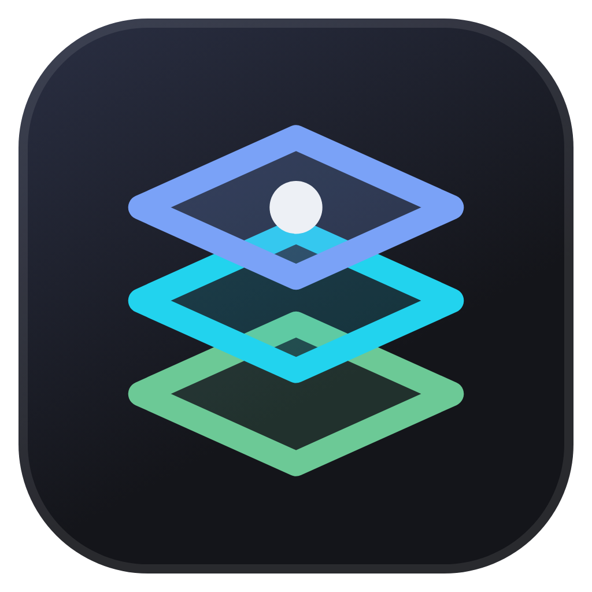
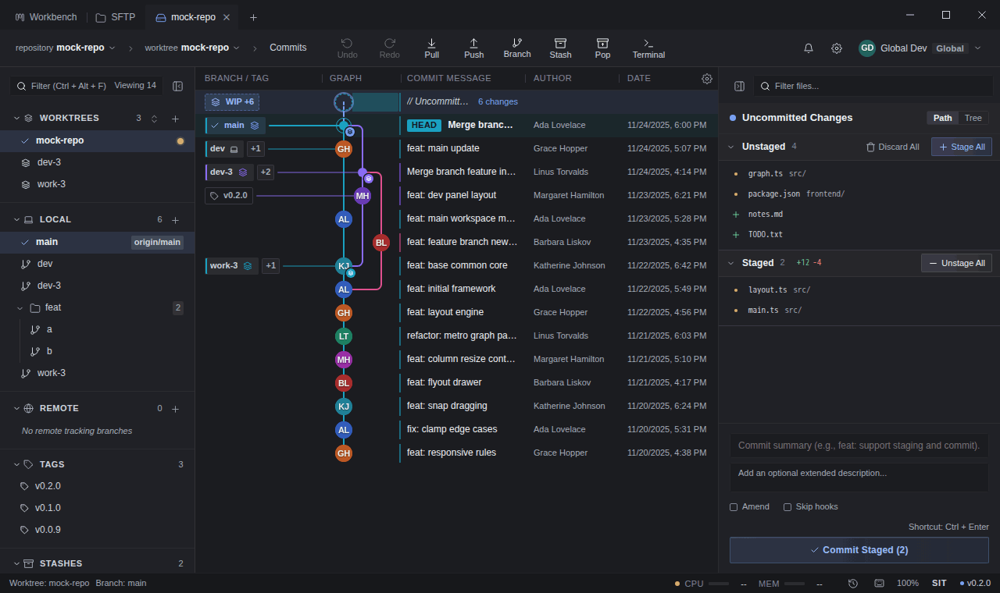
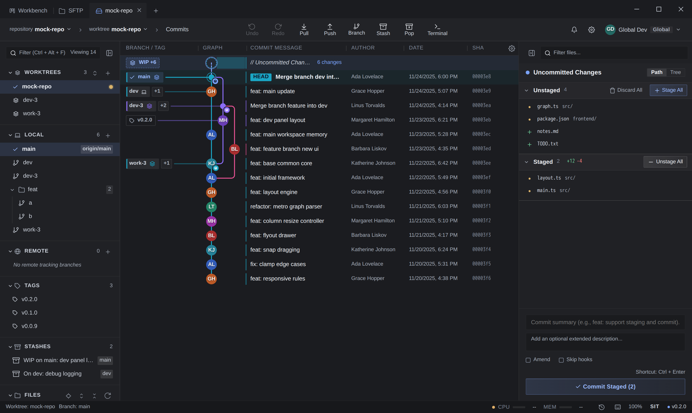
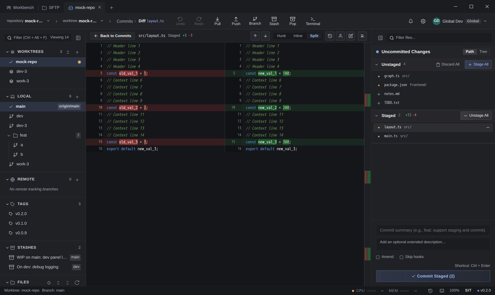
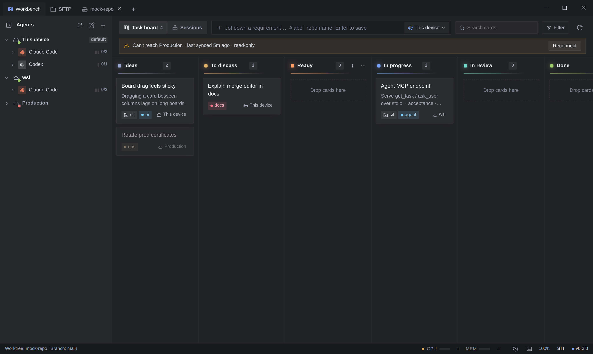
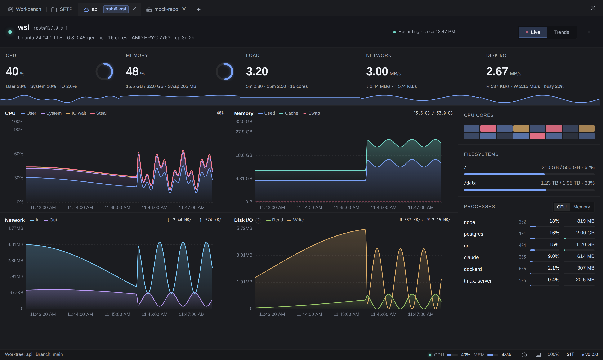
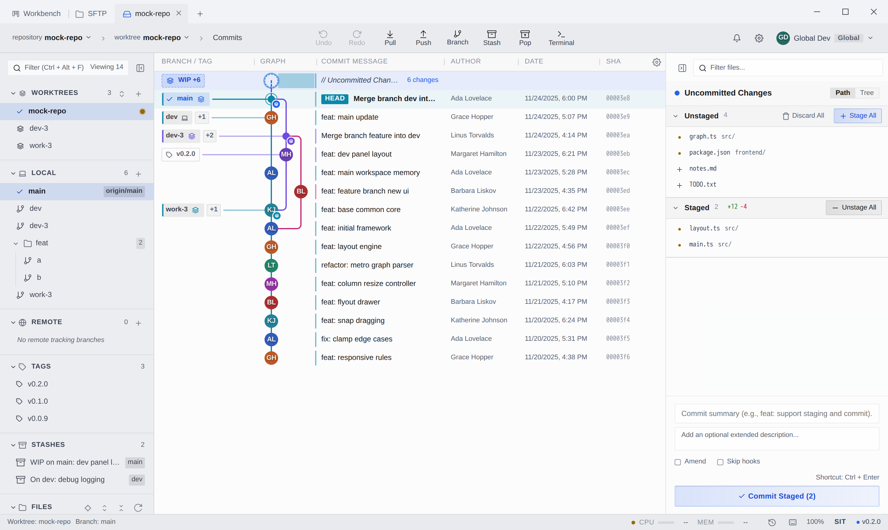

# SIT

**The Git workstation built around worktrees and remote machines.**

Open a repository on your laptop or on a server over SSH, and get the same graph, the same staging area
and the same terminal. Every worktree is a first-class place to work, for you and for the coding agents you send there.

[**Download**](https://github.com/3ks/sit_website/releases/latest) ·
[Website](https://3ks.github.io/sit_website/) ·
[All releases](https://github.com/3ks/sit_website/releases)

Windows 10/11 · macOS (Apple silicon, Intel) · connects to Linux, macOS and Windows machines

## Why SIT

- **Worktree first.** Worktrees sit at the top of the sidebar, not three menus deep. Create one, switch with a
  double-click, and see every worktree's HEAD marked on the graph. No more stash, switch, unstash.
- **Remote native.** Open a repository where it lives. SIT connects over SSH (your `~/.ssh/config`, including
  `ProxyJump` and `Include`), places a small agent in `~/.sit` without root, and runs git on that machine.
  Nothing to clone, nothing to keep in sync, and the server doesn't need internet access.
- **Byte-level fidelity.** Paths are bytes, not strings. SIT reads git only through its stable machine formats,
  so non-UTF-8 names, spaces and renames arrive exactly as git stores them.
- **Small and fast.** A native app on the system WebView, not a bundled browser. History streams in pages and only
  the visible rows are drawn, so a repository with hundreds of thousands of commits scrolls like a small one.

## Features

### Everyday Git

- **Commit graph** in a metro-map style: lanes, merges, avatars, branch and tag pills, worktree markers,
  and a dashed WIP node for uncommitted changes.
- **Stage precisely** by file, by hunk or by selected lines, in inline or side-by-side diffs with syntax highlighting.
- **Commit options**: amend, skip hooks, commit and push in one step.
- **Resolve conflicts in place** with a three-way merge editor and an editable result, for merge, rebase,
  cherry-pick and revert.
- **Right-click menus that know the state**: branches, remotes, tags, worktrees, stashes and commits each get the
  actions that make sense where they are, with confirmations for anything destructive.
- **File history** that follows renames, **blame**, and the history of just the lines you selected.
- **Stay in the window**: a file tree, a built-in editor, bookmarks on lines and commits, and several Git
  identities with avatars.

### Terminal

- A built-in terminal for every worktree, local or remote, backed by a bundled **tmux**: sessions survive a
  disconnect, a restart or a switch to another computer.
- Split panes, activity notifications, copy on select, and right-click paste.
- Paste a screenshot straight into the terminal: SIT saves it into the worktree and types the path for you.
- Pick a shell per repository (PowerShell, WSL, bash, zsh, fish…).

### Task board for coding agents

- A board of requirement cards with custom lists and labels, stored on the machine of your choice.
- Merge several cards into one task and turn it into a prompt.
- **Dispatch** a card to a coding agent such as Claude Code or Codex: SIT creates a worktree, starts the agent in
  tmux on that machine, and the agent reports progress, asks questions and hands work back for review through MCP.
- Agents keep working after you close SIT or disconnect; pick it up again from any device.

### Server monitor

- Live CPU, memory, load, network, disk I/O, filesystems and processes for the machine a repository lives on.
- Trends: the agent keeps recording in the background, so you can scroll back and see which processes were busy at
  any moment.

### Files between machines

- An SFTP view with two panes: drag files between any two machines, move and rename on the same side.
- Parallel transfers with a queue, elapsed time and average speed.

### Made to feel at home

- Light and dark themes, tuned separately, and window opacity.
- Six languages: English, 简体中文, 繁體中文, 日本語, Français, Español.
- Keyboard shortcuts throughout (⌘ on macOS).

## Install

Download the latest version from [Releases](https://github.com/3ks/sit_website/releases/latest).

| Platform | File |
|---|---|
| Windows 10/11 (x64) | `SIT-<version>-windows-amd64-setup.exe` (installs per user, no admin rights), or the portable `.zip` |
| macOS, Apple silicon | `SIT-<version>-darwin-arm64.dmg` |
| macOS, Intel | `SIT-<version>-darwin-amd64.dmg` |

The builds are not code-signed yet, so the first launch needs one extra step:

- **Windows**: when SmartScreen says "Windows protected your PC", click **More info → Run anyway**.
- **macOS 15 and later**: open SIT once and dismiss the warning, then go to **System Settings → Privacy & Security**
  and click **Open Anyway**. On macOS 14 and earlier, Control-click the app and choose **Open**.
  If macOS says the app is damaged, run `xattr -dr com.apple.quarantine /Applications/SIT.app`.

**Remote machines** need only SSH access and `git`. SIT installs its agent into `~/.sit` on first connect; if that
machine's platform isn't bundled in the installer, SIT downloads the matching `sit-agent-*` package from the release,
checks its SHA-256 against the value built into the app, and copies it over SSH.

Every release lists the SHA-256 of each file in `SHA256SUMS`.

## Feedback

Found a bug or have an idea? [Open an issue](https://github.com/3ks/sit_website/issues).

---

About this repository

This repository hosts the SIT website and the release downloads; the application source is not published here.

The site is plain static HTML served by GitHub Pages from `main` (no build step). Preview it locally with
`python3 -m http.server 8000`.

| Path | What it holds |
|---|---|
| `index.html` | The page. All English text lives here. |
| `assets/site.css` | Styles. The colour tokens and style families mirror the app's themes. |
| `assets/site.js` | Language, light/dark and style pickers, scroll reveal, release links. |
| `assets/i18n/<lang>.js` | One dictionary per language; a key missing from one falls back to English. |
| `assets/logo.svg`, `assets/icon.png` | Favicon and app icon. |
| `media/` | Screenshots used in this README. |

The download buttons link to `releases/latest` of this repository, and on load the page asks the GitHub API for the
latest release to point each button at its file and show the version and size (`REPO` in `assets/site.js`).

